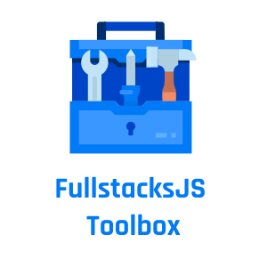

<div align="center">

<br/>
<br/>



<br/>
<br/>
<br/>

![download status][download-badge] ![version][version-badge]
![Code Coverage][coverage-badge] ![MIT License][license-badge]
![semantic-release][semantic-badge]

Welcome to Toolbox! A zero-dependency 📦 tree-shakable🌲 collection of missing
JavaScript utilities.

</div>

## Table of Contents <!-- omit in toc -->

<!-- cspell:disable -->

- [Installation](#installation)
  - [NodeJS](#nodejs)
  - [Deno](#deno)
  - [Browser](#browser)
- [Contributing](#contributing)
  - [Prerequisite](#prerequisite)
  - [Pull Request](#pull-request)
- [Code of Conduct](#code-of-conduct)
- [Documentation](#documentation)

<!-- cspell:enable -->

## Installation

### NodeJS

```sh
$ npm install --save-dev @fullstacksjs/toolbox
```

### Deno

```typescript
import * as toolbox from 'https://raw.githubusercontent.com/fullstacksjs/toolbox/main/mod.ts';
```

### Browser

This package is ESM-only.

```html
<script type="module">
  import * as toolbox from 'https://www.unpkg.com/@fullstacksjs/toolbox@<VERSION>/dist/index.mjs';
</script>
```

## Contributing

Development of toolbox happens in GitHub, and we appreciate contributions.

### Prerequisite

- [bash][bash]
- Node.JS>=20
- pnpm (or Vite+ / `vp`)

### Pull Request

The FullstacksJS team is monitoring for pull requests. We will go ahead and
review your pull request as soon as possible.

Before submitting a pull request, please make sure the following is done:

- Fork the repository and create your feature branch from main.
- Run `pnpm install` or `vp install` to have all dependencies.
- Run `vp test` while developing.
- Write tests in `src/<scope>/<name>.spec.ts` and implementation in
  `src/<scope>/<name>.ts`.
- Add JSDoc for you function with signature and examples.
- Add the documentation using [doc template](./docs/DOC-TEMPLATE.mdx) page to
  the `docs/content/<scope>/<function>.mdx` and update
  `docs/content/<scope>/_meta.ts` file.
- Ensure everything is ok with `vp check`.

## Code of Conduct

[FullstacksJS Rules Page](https://fullstacksjs.com/en/rules)

## Documentation

Please check out the [documentation page](https://toolbox.fullstacksjs.com)

[download-badge]:
  https://img.shields.io/npm/dm/@fullstacksjs/toolbox?color=EF6969&label=DOWNLOADS&style=flat-square
[version-badge]:
  https://img.shields.io/npm/v/@fullstacksjs/toolbox?color=098FAA&label=VERSION&style=flat-square
[coverage-badge]:
  https://raw.githubusercontent.com/fullstacksjs/toolbox/assets/assets/coverage.svg
[license-badge]:
  https://img.shields.io/npm/l/@fullstacksjs/toolbox?color=EA5F12&label=LICENSE&style=flat-square
[semantic-badge]:
  https://img.shields.io/badge/semantic-release-e10079.svg?logo=semantic-release&color=7E98F7&label=SEMANTIC&style=flat-square
  'https://github.com/semantic-release/semantic-release'
[nodejs]: https://nodejs.org/en/
[bash]: https://www.gnu.org/software/bash/
